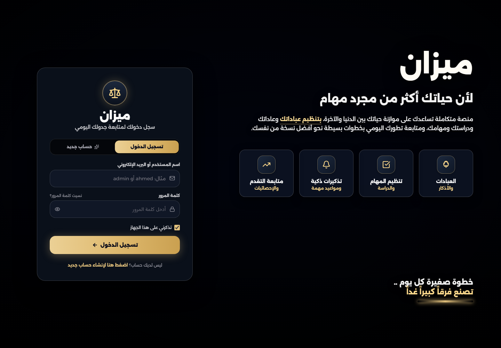

<div align="center">

# Mizan · ميزان

### Make room for what matters.

An Arabic-first daily planner that brings tasks, prayer times, and progress into one calm workspace.

[](https://daily-ten-rose.vercel.app/)
[](https://react.dev/)
[](https://www.typescriptlang.org/)
[](https://www.mongodb.com/)

[Try the live demo](https://daily-ten-rose.vercel.app/) · [Get started](#get-started) · [Deployment](#deployment) · [How sync works](#how-sync-works)

</div>

[](https://daily-ten-rose.vercel.app/)

*Actual screenshot of the public live demo. Create your own account to explore the planner; no shared demo credentials are provided.*

## The idea

Mizan means **balance**. It helps you plan a day around work, study, worship, and personal routines, then look back at what you accomplished. The interface starts in Arabic with right-to-left layouts and also supports English, light mode, and dark mode.

## Features

| Feature | What you can do |
| --- | --- |
| Daily planning | Add and edit tasks, set times, and mark them pending, done, or not done. |
| A flexible schedule | Keep multiple tasks in the same hour, use exact minutes, or leave tasks untimed. |
| Quick templates | Start with suggested tasks or a full-day schedule template. |
| Prayer times | Configure your location and calculation method, or set prayer times manually. |
| Progress and history | Review daily completion, browse archived days, and explore weekly reports. |
| Image exports | Download a daily schedule or weekly report as an image. |
| Account-based sync | Access the same account's tasks and preferences across browsers. |
| Local save queue | Keep edits in browser storage while the server is unavailable and retry synchronization. |
| Account separation | Keep each account's local data, server data, and pending changes separate. |
| Legacy recovery | Download old browser data or explicitly import it into your current account. |

## Built with

- **Frontend:** React 19, TypeScript, Vite, Tailwind CSS, and Lucide icons.
- **Backend:** Express, Mongoose, MongoDB, and Node.js.
- **Authentication:** Salted scrypt password hashes and signed HMAC session tokens.
- **Exports:** `html-to-image` with an embedded Arabic font for schedule exports.
- **Hosting:** Vercel Functions, with a Netlify Functions adapter included.
- **Verification:** Node's test runner through `tsx`, TypeScript checks, and production builds.

## Get started

Use **Node.js 22.12 or newer** and npm.

```bash
git clone https://github.com/ahmadessawii06/daily.git
cd daily
npm ci
npm run dev
```

Open **http://localhost:3000** and create an account. If port 3000 is occupied, the development server chooses another port and prints its URL.

No database setup is needed for local development. Without `MONGODB_URI`, the server stores accounts in `data/accounts.json` and creates a local session secret in `data/.session-secret`. Keep both files together when backing up local accounts. The local file store supports one server process; use MongoDB for shared or production deployments.

To configure MongoDB locally, copy the environment template:

```bash
cp .env.example .env
```

On PowerShell, use `Copy-Item .env.example .env`. Set the values described below, then restart the server.

## Environment variables

| Variable | Purpose | Required |
| --- | --- | --- |
| `MONGODB_URI` | MongoDB connection string, including the database name and database-user credentials. | Production |
| `JWT_SECRET` | A random, stable secret of at least 32 characters for signing sessions. | Production |
| `PORT` | Local server port; defaults to `3000`. | No |
| `DATA_DIR` | Alternative directory for the local file store. | No |

Generate a session secret locally:

```bash
node -e "console.log(require('node:crypto').randomBytes(48).toString('hex'))"
```

Keep secrets in server environment variables. Do not commit `.env`, database credentials, or account data, and do not prefix secrets with `VITE_`. Changing `JWT_SECRET` invalidates existing sessions.

## Deployment

### Vercel

1. Import this GitHub repository into Vercel.
2. Choose the directory containing `package.json` and `vercel.json` as the **Root Directory**. This is the repository root; in an outer workspace containing a nested `daily` folder, choose that inner folder.
3. Use **`npm run build`** as the build command and **`dist`** as the output directory.
4. Add `MONGODB_URI` and `JWT_SECRET` to the **Production** environment. Add them to Preview too if preview deployments need working accounts.
5. Confirm the MongoDB cluster is running, the database user has read/write access, and the Atlas IP access list allows the deployment's network connection.
6. Deploy. After changing environment variables, create a new deployment.

`vercel.json` routes `/api/*` to the Express function and frontend routes to `index.html`.

### Netlify

Import the same repository, choose the same project root, and set the server environment variables above. `netlify.toml` provides the build settings and API redirects; `netlify/functions/api.ts` adapts the shared Express API.

### A Node server

```bash
npm run build
```

Set `NODE_ENV=production`, `MONGODB_URI`, and `JWT_SECRET` in your hosting environment, then run `npm start`. The Node server serves both `dist` and the API.

## How sync works

1. Edits are saved locally and queued under the active account.
2. The client sends the queue to `/api/sync/batch` with its session token.
3. The server merges task changes and persists the account state in MongoDB.
4. Acknowledged changes leave the queue. Edits made while a request is running remain queued for the next request.

Task timestamps and deletion markers prevent stale uploads from restoring deleted tasks. Habits, recurring items, and settings use collection-level versions. MongoDB updates also check the account revision to prevent concurrent requests from overwriting each other.

The sync indicator shows pending changes, errors, and the last successful sync. Click it to retry immediately. When the server is unavailable, edits remain queued in that browser; they are not available on another device until synchronization succeeds. The app does not provide a service worker for loading the site offline.

### Verify a deployment

```bash
curl https://daily-ten-rose.vercel.app/api/health
```

A healthy production response is:

```json
{"connected":true,"database":"MongoDB"}
```

To check synchronization end to end, create a test task, wait for **Synced** and an empty pending count, then sign into the same account in another browser and view the same date.

If synchronization fails, inspect **Network → `/api/sync/batch` → Response** and the matching `API failure:` entry in the hosting logs. A healthy `/api/health` confirms database access, but does not by itself verify an account's sync request. Keep browser storage intact while changes are pending.

## Project structure

```text
daily/
├── api/                  # Vercel function entry
├── backend/              # Shared Express API, persistence, auth, and local startup
├── docs/images/          # README screenshots
├── netlify/functions/    # Netlify API adapter
├── scripts/              # Generated-file cleanup
├── src/
│   ├── assets/images/    # Bundled application images
│   ├── components/       # Active React interface
│   ├── services/         # API client and sync queue/engine
│   ├── shared/           # Shared task merge logic
│   ├── types/            # TypeScript domain models
│   └── utils/            # Storage, dates, prayer times, analytics, and exports
├── tests/                # Backend, client, sync, startup, and ESM regressions
├── .env.example          # Environment template without credentials
├── server.ts             # Local development and standalone production server
├── netlify.toml          # Netlify deployment configuration
└── vercel.json           # Vercel deployment configuration
```

`data/`, `dist/`, `node_modules/`, hosting metadata, and temporary test directories are local or generated files and are excluded from Git.

## Development commands

| Command | Purpose |
| --- | --- |
| `npm run dev` | Run the local frontend and API together. |
| `npm start` | Run the shared Node server using the current environment. |
| `npm run lint` | Check TypeScript types. |
| `npm test` | Run the regression suite. |
| `npm run build` | Check types and build the frontend for production. |
| `npm run preview` | Preview built frontend assets only; does not run the API. |
| `npm run clean` | Remove generated build and temporary test artifacts; preserve account data. |

Tests cover authentication, persistence, account isolation, merge/deletion behavior, queued changes, MongoDB initialization and missing fields, deployment adapters, occupied ports, and native Node ESM imports. Database behavior is covered with mocks and local storage; the suite does not require or verify a real Atlas cluster.

## Existing data

Older browser-only accounts are not automatically migrated to server accounts. Sign into a server account, open Settings, download a backup of detected legacy data, and import it explicitly if it belongs to you. Legacy local `data/users.json` and `data/days.json` are preserved when present, but the current server uses `data/accounts.json`. All local data files are excluded from new Git commits.

## Contributing

Open an issue with a reproducible example or submit a focused pull request. Before submitting a change, run `npm test` and `npm run build`. For sync issues, include the response status and a redacted server error, never a token, password, or connection string.
