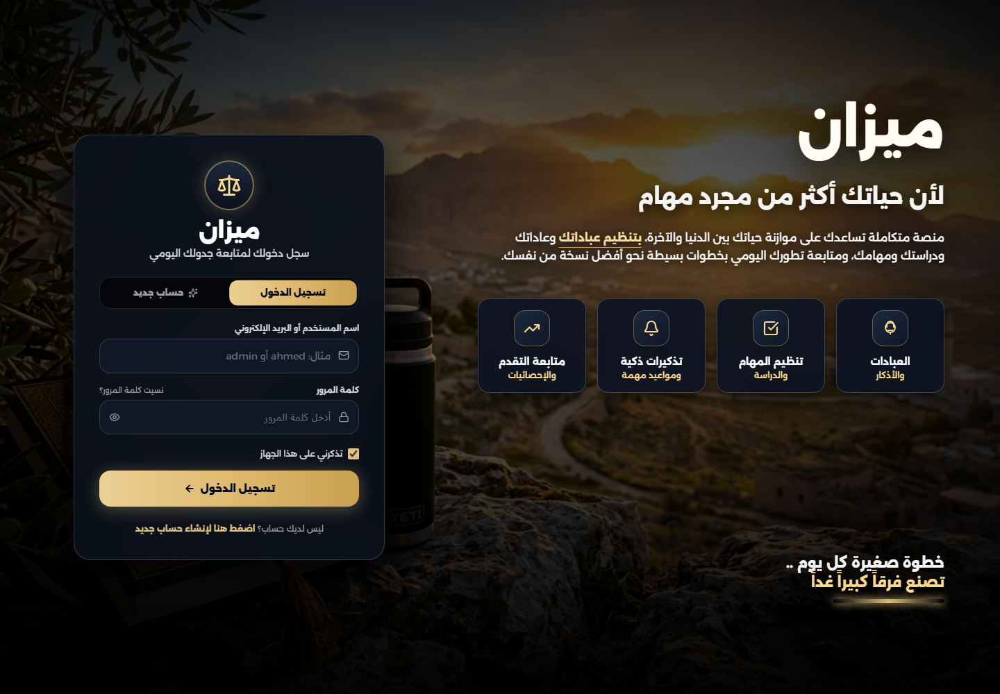
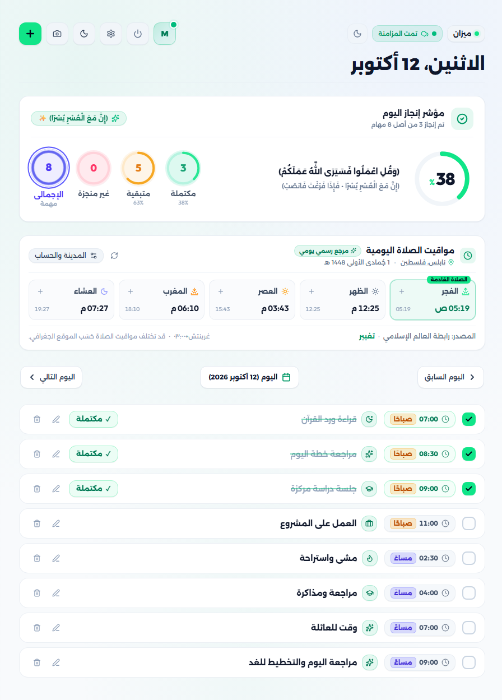
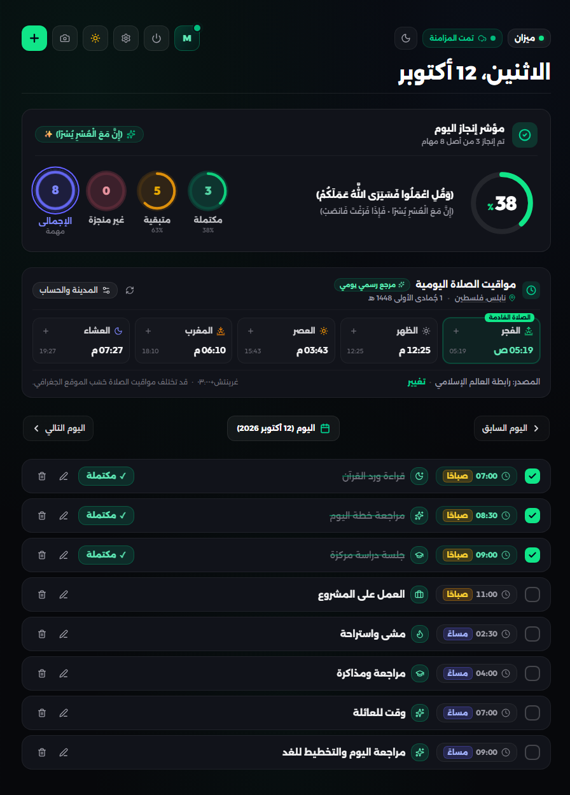

<picture>
  <source media="(prefers-color-scheme: dark)" srcset="docs/images/banner-dark.svg">
  <source media="(prefers-color-scheme: light)" srcset="docs/images/banner-light.svg">
  
</picture>

<p align="center"><strong>A daily planner for a balanced life.</strong><br>Tasks, prayer times, and progress. Arabic-first, with English support.</p>

<p align="center">
  <a href="https://github.com/ahmadessawii06/daily/actions/workflows/ci.yml"></a>
  <a href="https://react.dev/"></a>
  <a href="https://www.typescriptlang.org/"></a>
  <a href="https://www.mongodb.com/"></a>
</p>

<p align="center"><a href="https://daily-ten-rose.vercel.app/"><strong>Open live demo ↗</strong></a> &nbsp; · &nbsp; <a href="#quick-start">Run locally</a> &nbsp; · &nbsp; <a href="docs/DEPLOYMENT.md">Deploy your own</a></p>

---

## 🚀 Project Overview

**Mizan** (ميزان, “balance”) brings daily planning, prayer times, and progress into one workspace. Plan around your own rhythm, track what gets done, and pick up your day in another browser with account-based synchronization.

**Arabic-first & RTL** · **English support** · **Light & dark themes** · **Responsive interface**

## ✨ Key Features

<table>
  <tr>
    <td width="50%"><strong>🗓️ A flexible daily plan</strong><br>Exact times, multiple tasks per hour, untimed tasks, and quick schedule templates.</td>
    <td width="50%"><strong>🕌 Prayer times in context</strong><br>Location and calculation settings, with manual prayer-time configuration.</td>
  </tr>
  <tr>
    <td><strong>📊 Progress you can see</strong><br>Completion indicators, archived days, and weekly reports.</td>
    <td><strong>☁️ Your account, across browsers</strong><br>Server-backed sync with a local queue that retains pending edits during connection failures.</td>
  </tr>
  <tr>
    <td><strong>🖼️ Shareable snapshots</strong><br>Export daily schedules and weekly reports as images.</td>
    <td><strong>🔐 Separate account data</strong><br>Salted password hashes, signed sessions, and storage scoped to each account.</td>
  </tr>
</table>

<a id="preview"></a>

## 🖼️ Screenshots & Preview

<p align="center">
  <a href="https://daily-ten-rose.vercel.app/">
    
  </a>
</p>

<sub>Actual public live-demo preview. Click the image to open Mizan.</sub>

<details>
<summary><strong>☀️🌙 Explore the planner in light and dark themes</strong></summary>

<table>
  <tr>
    <th width="50%">☀️ Light workspace</th>
    <th width="50%">🌙 Dark workspace</th>
  </tr>
  <tr>
    <td><a href="docs/images/planner-light.png"></a></td>
    <td><a href="docs/images/planner-dark.png"></a></td>
  </tr>
</table>

<sub>Actual captures of the running app with a local example account. Same day, same tasks, both themes. Click either image for full resolution.</sub>

</details>

**[Explore the live demo →](https://daily-ten-rose.vercel.app/)** Create your own account to try the planner.

---

<a id="quick-start"></a>

## ⚡ Quick Start

**Node.js 22.12+** and **npm** are required. Run these commands from a terminal:

```bash
git clone https://github.com/ahmadessawii06/daily.git
cd daily
npm ci
npm run dev
```

Open **http://localhost:3000**. The server prints another port if 3000 is in use.

> 💡 Local development works without MongoDB. Production deployments require `MONGODB_URI` and `JWT_SECRET`.

<details>
<summary><strong>📦 Installation details & local persistence</strong></summary>

The development server runs the React frontend and Express API together. Local accounts are saved in `data/accounts.json`, with the session secret in `data/.session-secret`. Back up both together.

To configure a database, create `.env` from `.env.example` if it does not already exist. Restart the server after changing it.

**[Complete setup guide →](docs/DEVELOPMENT.md#local-setup)**

</details>

## 🛠️ Technologies Used

| Layer            | Tools                                                 |
| :--------------- | :---------------------------------------------------- |
| Interface        | React 19 · TypeScript · Tailwind CSS · Lucide      |
| Build            | Vite ·`tsx` · esbuild                             |
| Server & storage | Express · Mongoose · MongoDB · Node.js             |
| Authentication   | scrypt password hashing · HMAC-signed session tokens |
| Image exports    | `html-to-image` · embedded Arabic export font      |
| Hosting & checks | Vercel Functions · Netlify adapter · GitHub Actions |

## ⚙️ Configuration

| Variable        | Local development                          | Production                       |
| :-------------- | :----------------------------------------- | :------------------------------- |
| `MONGODB_URI` | Optional; defaults to the local file store | Required                         |
| `JWT_SECRET`  | Generated and persisted when omitted       | Required; at least 32 characters |
| `PORT`        | Optional; defaults to`3000`              | Host-dependent                   |
| `DATA_DIR`    | Optional local storage directory           | MongoDB is used                  |

<details>
<summary><strong>🚢 Deployment & secret configuration</strong></summary>

Import the repository into Vercel, set the build command to `npm run build`, and use `dist` as the output directory. Add the server variables above and confirm Atlas allows the deployment to connect.

Keep credentials in server environment variables. Do not commit `.env` or use the `VITE_` prefix for secrets. Create a new deployment after changing hosting variables.

**[Vercel, Netlify, and Node deployment guide →](docs/DEPLOYMENT.md)**

</details>

## 📁 Project Structure

<details>
<summary><strong>Explore the source layout</strong></summary>

```text
.
├── api/                   Vercel function entry
├── backend/               Express API, MongoDB, authentication, persistence
├── docs/                  Setup guides and verified screenshot assets
├── netlify/functions/     Netlify adapter for the shared API
├── scripts/               Generated-file cleanup
├── src/
│   ├── assets/            Bundled application images
│   ├── components/        React interface
│   ├── services/          API client, synchronization, pending queue
│   ├── shared/            Shared task-merge logic
│   ├── types/             Domain models
│   └── utils/             Dates, storage, prayer times, analytics, exports
├── tests/                 Backend, client, sync, and deployment regressions
└── server.ts              Local and standalone Node server
```

Local data, credentials, dependencies, and generated builds are excluded from Git.

</details>

## 💻 Development Guide

```bash
npm test          # Regression suite
npm run build    # TypeScript checks + production frontend build
```

GitHub Actions runs both checks on pushes and pull requests.

<details>
<summary><strong>☁️ Understand and verify synchronization</strong></summary>

Edits move from account-scoped local storage into a pending queue, then through an authenticated batch API. The server merges task timestamps and deletion markers, and checks account revisions before saving.

To verify it: add a task, wait for **Synced / تمت المزامنة** and an empty pending count, then sign into the same account in another browser and open the same date.

Edits remain in the originating browser until sync succeeds. The app currently has no service worker for loading the site offline.

**[Sync behavior, troubleshooting, and all commands →](docs/DEVELOPMENT.md)**

</details>

## 🤝 Contributing

Focused pull requests and reproducible bug reports are welcome. Run `npm test` and `npm run build` before submitting changes. For sync issues, include a redacted response status and server error; keep tokens, passwords, and connection strings private.

**[Open an issue](https://github.com/ahmadessawii06/daily/issues)** · **[Development guide](docs/DEVELOPMENT.md)**

## 🗺️ Roadmap

Proposed next steps:

- [ ] Browser-based end-to-end checks for cross-browser synchronization.
- [ ] Automated regeneration and validation of documentation screenshots.
- [ ] Service-worker support for reopening the app offline.

## 📜 License

A license has not been selected for this repository. No `LICENSE` file is currently included; review the licensing status before reusing or redistributing the code.

---

<div align="center">
  <strong>Plan with intention. Build a balanced day.</strong><br>
  <sub>Mizan · ميزان</sub>
</div>
